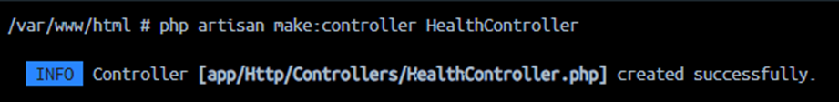
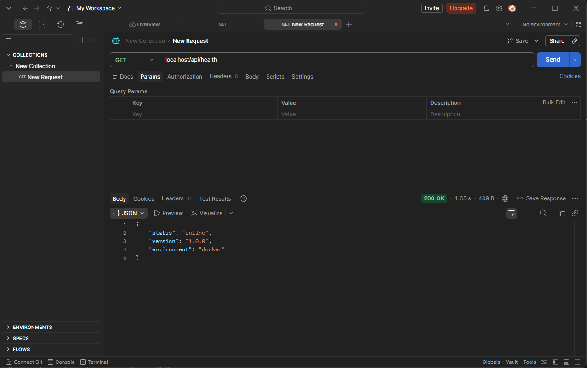
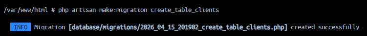
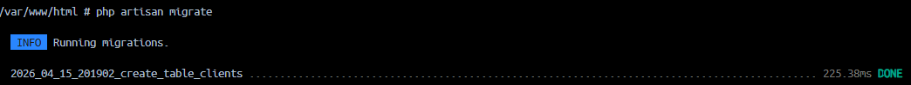
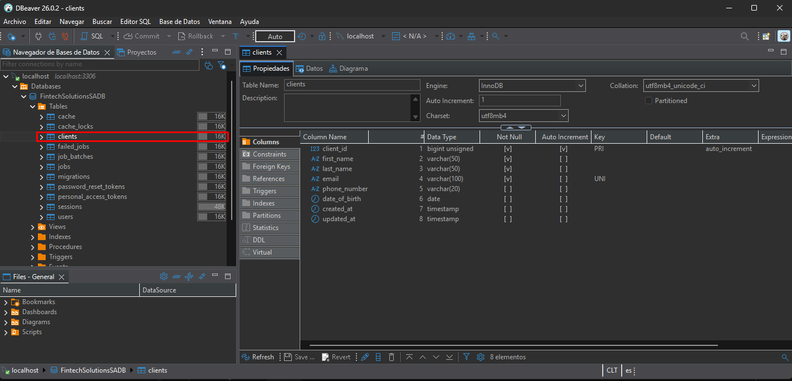

# Readme.md LaravelOneCommand
INTEGRANTES: LUIS HERNANDEZ / TOMAS LOPEZ FRANULIC / JAVIER ARROYO MENDEZ
**Rol del Backend:** El backend es la lógica del negocio, y consiste en toda la estructura que sirve de puente entre la interfaz de Fintech que el usuario ve e interactua, y la base de datos que almacena la informacion. Ese puente que constituye el backend debe ser uno tal que sea capaz de conservar la integridad de la informacion asi como tambien garantizar la seguridad tanto del usuario como de la propia informacion alamacenada y la estructura misma (definir y acotar permisos y autorizaciones). El backend recibe la peticion del usuario y ejecuta la logica (ve quien envia la informacion, calcula, verifica permiso, etc) gestionando la informacion de la base de datos. Tras esta logica se genera una respuesta estructurada generalmente devuelta en formato JSON. Este puente que es el backend garantiza coherencia y eficiencia entre cliente, servidor y base de datos.

**Diagrama:** El modelo es el dato, la vista la respuesta al cliente respecto del dato, y el controlador el interpmediario. En ese sentiduo un diagrama basico del flujo en cuestion es USUARIO > CONTROLADOR > MODELO > VISTA > USUARIO. En detalle NGINX es el servidor por el cual el usuario ingresa las peticiones (por ej. GET).
La deriva al contenedor de PHP
Ahi el archivo de Ruta busca el controlador asignado y se ejecuta el metodo.
Se genera la respuesta y se asigna el codigo.
El motor php devuelve al cliente esta respuesta en JSON a traves del NGINX donde comenzo todo.

**Criterios de Calidad del SPRINT 0**
Modularidad> Se utiliza el controlador "Health"
Mantenibilidad> Se realizan migraciones evitando los scripts de SQL dandole escalabilidad y portabilidad (database/seeders y migrations)
Claridad de configuracion> El archivo .env en la raiz garantiza rapidez de modificacion sin afectar la fuente siendo una estrategia segura, que de la mano con la automatizacion del init.sh le da dinamismo para la inyeccion de datos. 
Separacion de Responsabilidades> El patron MVC separa codigos siendo mas preciso y eficiente la eventual reparacion de los codigos.
Trazabilidad> El uso de codigos de estado HTTP estandar facilita el monitoreo de los fallos y da uniformidad a las respuestas


1. Configura tu .env.
2. ```docker compose up``` Para crear el container con los servicios requeridos.
3. Espera y verifica que se haya creado el proyecto.
4. ```docker compose exec php php artisan migrate``` Para migrar la base de datos. (Si es necesario)

### ¿Que hace el proyecto?
Para empezar se configura un contenedor los servicios de PHP, MySQL y Nginx con docker-compose.yml. Dentro de PHP se encuentra un Dockerfile que se encarga de instalar las dependencias del sistema a utilizar, extensiones de PHP necesarias y descarga la ultima version de composer para posteriormente establecer el directorio de trabajo y ejecutar el script init.sh que se encarga de crear el proyecto Laravel, dentro de este init.sh, verifica si ya existe el proyecto Laravel comprobando si existe un archivo 'artisan', en caso de que no exista, crea el proyecto. Posteriormente configura el .env del proyecto, tomando los datos del .env de la raiz y reemplaza la configuracion con sed y posteriormente las descomenta, para finalizar establece los permisos necesarios y ejecuta php-fpm.
Para el caso del servicio de MySQL, este se configuro en el puerto default (3306).
Se utiliza Nginx y su respectivo default.conf para renderizar la aplicacion web.

# Readme.md eva1_Hernandez_Luis

Get/metodo check
1.- Ingresamos al contenedor php y ejecutamos ```php artisan make:controller HealthController``` y se crea el controlador en ```app/Controllers/HealthController.php```


2.- Creamos el metodo check
```php
public function check() {
 return response()->json([
 "status" => "online",
 "version" => "1.0.0",
 "environment" => "docker"
 ], 200);
}
```
3.- En laravel 12 no existe api.php, por lo cual utilizamos ```php artisan install:api``` para crear esta ruta.
Agregamos la ruta ```Route::get('/health', [HealthController::class, 'check']);```, sin antes importar el controlador con ```use App\Http\Controllers\HealthController;```

4.- Verificamos con una peticion GET 


Migracion de datos
1.- Ingresamos al contenedor php y ejecutamos ```php artisan make:migration create_table_clients```, lo cual crea un archivo en ```database/migrations```

2.- La tabla es la siguiente
```sql
CREATE TABLE clients (
    client_id INT UNSIGNED AUTO_INCREMENT PRIMARY KEY,
    first_name VARCHAR(50) NOT NULL,
    last_name VARCHAR(50) NOT NULL,
    email VARCHAR(100) NOT NULL UNIQUE,
    phone_number VARCHAR(20),
    date_of_birth DATE,
    created_at TIMESTAMP DEFAULT CURRENT_TIMESTAMP,
    updated_at TIMESTAMP DEFAULT CURRENT_TIMESTAMP
) ENGINE=InnoDB;
```
Pero necesitamos transformarla a la estructura de laravel, por lo cual en el archivo de migracion quedaria asi:
```php
public function up(): void
{
      Schema::create('clients', function (Blueprint $table) {
        $table->id('client_id');
        $table->string('first_name', 50);
        $table->string('last_name', 50);
        $table->string('email', 100)->unique();
        $table->string('phone_number', 20)->nullable();
        $table->date('date_of_birth')->nullable();
        $table->timestamps();
     });
}
```
Donde factores como el primary key se manejan con $table->id(), los varchar con $table->string() y se especifica la longitud, los unique con ->unique() que no permite duplicados, los nullable con ->nullable() que permite valores nulos y los timestamps con ->timestamps() que crea dos columnas para la fecha y hora de creacion y actualizacion.

3.- Ejecutamos la migracion con ```php artisan migrate```


4.- Verificamos con dbeaver que la tabla se creo correctamente.


